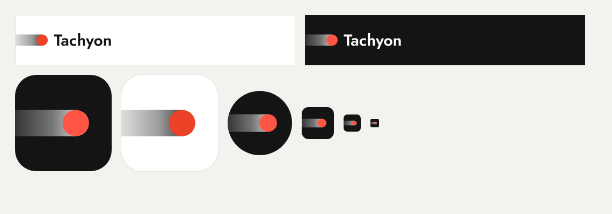

# Tachyon 로고 · 앱 아이콘

사람이 11-12 00:14·00:15에 골랐다. 시안: [로고 시안](https://claude.ai/artifact/Ni199KuYxKQBMVSS7hEvUv) · [A 변주](https://claude.ai/artifact/XoDoYiBDY8dpdyfUVB7Ezn) (archi142857만 열 수 있다).



- **로고 = A18-1.** 점(입자)이 왼쪽 벽에서 나와 오른쪽으로 가며, 점 지름만큼 굵은 띠를 남긴다. 띠는 벽 쪽으로 옅어진다(머리 쪽 75% → 벽 14%). 점 지름 = 글자의 대문자 높이, 점 가운데 = 대문자 높이 가운데. 점은 로고 빨강 하나: 밝은 바탕 #ec4227, 어두운 바탕 #ff5545(11-12 00:21 사람 '라이트 모드에서 빨간 점이 좀 까매 보임' → 앱의 '지금' 색 #c4321e보다 밝게, 띠 머리 쪽도 92% → 75%로 옅게 해서 점과 띠가 갈리게).
- **앱 아이콘 = I1.** 같은 모양을 타일에 그렸다. 점 지름 = 타일 폭의 27%(512 기준 반지름 70, 가운데 x 322). 띠는 타일 왼쪽 벽까지 닿는다. 어두운 타일 #141414, 흰 띠, 빨간 점 #ff5545.
- 글자는 Jost 600(SIL OFL 1.1, github.com/indestructible-type/Jost)을 선으로 바꾼 것이라 글꼴이 없어도 똑같다. 로고 그림에 글꼴 윤곽을 쓰는 것은 OFL이 허락한다.

## 파일

| 파일 | 어디에 |
|---|---|
| `icon.svg` | `web/public/icons/icon.svg` — 브라우저 탭 아이콘, manifest `any`. 둥근 타일 |
| `icon-maskable.svg` | `web/public/icons/icon-maskable.svg` — 꽉 찬 사각. 점은 안전 영역(가운데 80% 원) 안 |
| `icon-192.png` · `icon-512.png` | 같은 이름으로. 둥근 타일, 모서리 투명 |
| `icon-maskable-512.png` | 같은 이름으로. 꽉 찬 사각 |
| `apple-touch-icon.png` | 같은 이름으로. 180, 꽉 찬 사각(아이폰이 모서리를 깎는다) |
| `icon-light.svg` | 밝은 타일 판. 지금은 안 쓴다 |
| `logo.svg` · `logo-dark.svg` | 밝은·어두운 바탕용 로고(문서·발표 자료). 띠는 그림 왼쪽 끝(= 벽)에서 시작 |
| `Logo.jsx` | 앱 안 로고 컴포넌트 초안 → `web/src/components/Logo.jsx`. 띠 `--text`, 글자 `--heading`은 테마를 따르고, 점은 `light-dark(#ec4227, #ff5545)`(테마의 color-scheme으로 고름) |
| `미리보기_로고_아이콘.png` · `미리보기_앱안.png` | 확인 그림(앱 안 그림은 예시 자료, 바우하우스 · 입자 밤) |

## 쓰는 규칙

- 띠는 늘 담긴 칸의 **왼쪽 벽에 닿는다.** 칸의 왼쪽 안쪽 여백만큼 로고를 당긴다(아래 CSS).
- 띠 굵기 = 점 지름. 늘이거나 눌러 비율을 바꾸지 않는다. 로고 파일의 띠 길이(벽 → 점 왼쪽 끝)는 점 지름의 약 1.9배다.
- 점 색은 로고 빨강 하나(밝은 바탕 #ec4227 · 어두운 바탕 #ff5545). 다른 색으로 바꾸지 않는다. 그래픽이라 흰 바탕 3.9:1(표시 3:1 넘김).
- 로고 높이는 20px 이상. 둘레(오른쪽 · 위 · 아래)는 점 지름만큼 비운다. 왼쪽은 벽이다.

## 화면 세션이 붙이는 법

1. 아이콘 여섯 개(`icon.svg` `icon-maskable.svg` `icon-192.png` `icon-512.png` `icon-maskable-512.png` `apple-touch-icon.png`)를 `web/public/icons/`에 같은 이름으로 덮어쓴다. `sw.js`가 아이콘을 캐시해 두면 캐시 이름을 올린다.
2. `Logo.jsx`를 `web/src/components/`에 두고, `<h1 className="wordmark">Tachyon</h1>` 네 곳(`TopBar.jsx`, `Login.jsx`, `Dashboard.jsx`의 왼쪽 메뉴 · 폰 위 막대)을 `<h1 className="wordmark"><Logo height={…} /></h1>`로 바꾼다. 높이는 위 막대 22~24, 왼쪽 메뉴 26, 로그인 40.
3. CSS(shell.css 끝 등):

```css
/* 로고: 띠가 담긴 칸의 왼쪽 벽에 닿게 — 칸의 왼쪽 안쪽 여백만큼 당긴다 */
.wordmark .logo { display: block; width: auto; }
.topbar > .wordmark { margin-left: -20px; }        /* styles.css .topbar 왼쪽 여백 20 */
.shell .topbar > .wordmark { margin-left: -16px; } /* shell.css 폰 위 막대 16 */
.side-brand { padding-left: 0; }                   /* 넓은 화면 왼쪽 메뉴: 메뉴 왼쪽 끝이 벽 */
.login .wordmark { margin-left: -24px; }           /* 로그인 칸 왼쪽 여백 24 */
```

디자인 세션이 web 사본(11-12 00:1x main)에 1~3을 넣어 봤다: `npm test` 81개 통과(`campus.test.js`는 사본에 `data/`가 없어 못 돌림), `?example` 390×844 · 1366×768, 바우하우스 · 입자 밤에서 화면 오류 없이 띠가 벽에 닿는 것을 봤다([미리보기_앱안.png](미리보기_앱안.png)).
