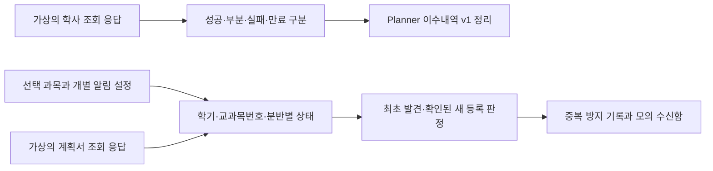

# 학교 조회 경로 조사와 모의 연결

확인일: 2026-11-07 (한국 시간). 담당: Project / Backend / Integrations.
기준 커밋: `758192a`. 관련 목표: G01·G02·G08의 개인 입력 연결, G21 계획서 등록 알림, G22 자료 갱신과 불확실성.

**공개 안내에서 사람이 찾아갈 경로는 확인했다. 개인 이수내역·확정 전공·계획서 게시 상태를 외부 프로그램에 제공하는 공식 API(프로그램 간 자료 교환 방식)는 이번 조사 범위에서 확인하지 못했다.** API가 없다는 뜻은 아니다. 실제 로그인, 계정 연결, 내부 요청 분석, 크롤링, 정기 조회, 외부 알림, GPT Actions는 수행하지 않았다. 공개 문서 열람은 실제 학사 조회 검증과 구분한다.

## 1. 공식 근거와 확인 수준

아래는 문서 내용을 확인한 날짜이며 학교의 회신일이나 시스템 동작 보증일이 아니다. 개인 성적표·학생 명단·교수 이름·계정 자료와 화면은 저장하지 않는다.

| ID | 공식 자료·위치 | 확인한 사실 | 확인하지 못한 것 |
| --- | --- | --- | --- |
| S1 | [서울대학교 정보화서비스](https://www.snu.ac.kr/campuslife/aid/it), SNU 통합 ID·마이스누·학사정보·스누지니 절 | 학교 주요 서비스는 SNU 통합 ID를 사용한다. 마이스누가 공식 접속 채널이며 학사정보의 성적 조회, 스누지니의 학업 이수현황 제공을 안내한다. | 외부 서비스 인증 위임, API, 읽기 권한, 토큰 만료, 전체 이수내역의 응답 형식. 학교 서비스 기능 소개는 제3자 사용 허가가 아니다. |
| S2 | [경제학부 학부 공지, 게시물 11409](https://econ.snu.ac.kr/announcement/notice?bbsidx=11409&bm=v), 누적성적표·개인별 성적내역 안내 | 마이스누 → 학사정보시스템 → 수업/성적 → 성적 → 나의성적 경로를 안내한다. | 전체 학기·재수강·취득 확정·교과구분 변경을 외부에서 읽는 방법과 완전성 보장. 해당 공지의 졸업요건을 다른 전공에 적용하지 않는다. |
| S3 | [융합학습과학전공 2027-1 다전공 선발 안내](https://tls.snu.ac.kr/new2/sub_community/notice.php?b_name=notice&mode=view&number=153&page=1), 2026-09-21, 공통 사항·신청방법 | 마이스누 학사/행정 → 학적변동/다전공 → 신청 → 전공/과정신청, 다전공선발정보 경로가 안내돼 있다. | 개인의 현재 확정 주전공·복수전공 전체를 반환하는 조회 메뉴/API. **신청 가능 전공·신청 기록을 현재 이수 전공으로 간주하지 않는다.** |
| S4 | [2026-1 기초교양 수강편람, 학부대학 공개 PDF](https://snuc.snu.ac.kr/wp-content/uploads/sites/305/2026/01/%E2%98%852026%ED%95%99%EB%85%84%EB%8F%84-1%ED%95%99%EA%B8%B0-%EA%B8%B0%EC%B4%88%EA%B5%90%EC%96%91-%EC%88%98%EA%B0%95%ED%8E%B8%EB%9E%8C%EB%B0%B0%ED%8F%AC2_%EC%95%95%EC%B6%95.pdf), 인쇄 6쪽 ‘다. 강의계획서 열람’ | 수강신청사이트 → 교과목 검색 → 교과목 선택 → 교과목 상세 정보 → 강의계획서 경로. 마이스누 수강편람조회 경로도 제시한다. | 모든 분반의 원문 열람 가능 여부, 비로그인 접근 범위, 게시/미게시 판별값, 원문 직접 링크, 업로드 시각, 자동 수집 조건. |
| S5 | [2026-1 기초교양 수강편람 배포본](https://snuc.snu.ac.kr/wp-content/uploads/sites/305/2026/01/%E2%98%852026%ED%95%99%EB%85%84%EB%8F%84-1%ED%95%99%EA%B8%B0-%EA%B8%B0%EC%B4%88%EA%B5%90%EC%96%91-%EC%88%98%EA%B0%95%ED%8E%B8%EB%9E%8C%EB%B0%B0%ED%8F%AC.pdf), 인쇄 11쪽 ‘마. 강좌검색’ | 강좌명에서 상세 정보·계획서를 열람하는 흐름. 이전학기 상세검색은 이용이 몰리는 특정 기간에 제한될 수 있다. 관심강좌 저장은 로그인이 필요하다. | 이 제한으로부터 자동 조회 빈도나 외부 알림 허용을 추론할 수 없다. 관심강좌의 로그인 조건을 모든 공개 검색의 조건으로 확대하지 않는다. |
| S6 | [자유전공학부 영어 과목 강의계획서 안내](https://cls.snu.ac.kr/notice/editor/?mod=document&pageid=164&uid=78126), 2022-08-05 본문 | 영어 강의의 계획서 내용이 조회되지 않을 수 있다는 과거 안내가 있다. | 현재도 같은 문제인지 이번에 재현하지 않았다. 빈 결과를 미등록으로 판단할 수 없다는 설계상 근거로만 사용한다. |

문서 열람 한계: [수강신청 사이트](https://sugang.snu.ac.kr/)는 조사 도구에 읽을 수 있는 본문이 반환되지 않았다. 이는 학교 장애·접근 금지·계획서 미등록을 입증하지 않는다. [기존 수강신청 매뉴얼](https://sugang.snu.ac.kr/kor/guide/manual.pdf)은 검색 색인에서 24쪽 강좌상세정보 안내를 확인했으나 직접 열람은 파일 크기 제한으로 실패했다. 위 S4·S5의 공개 PDF 본문을 확인해 경로 근거를 보완했다. PDF 전체나 화면은 저장소에 복제하지 않았다.

검색 범위: `snu.ac.kr` 공식 사이트 및 하위 사이트에서 ‘이수내역 마이스누’, ‘성적 누적 조회’, ‘다전공 학적변동’, ‘강의계획서 조회 수강신청’, ‘학사 API / Open API / OpenAPI 정보화본부’를 검색했다. 도서 추천 API 등 다른 업무의 API는 이번 세 항목의 제공 근거로 사용하지 않았다. 검색으로 찾지 못한 API를 부재 확정으로 표시하지 않는다.

## 2. 가능한 방식·필요 조건·미확인 사항

| 대상·방식 | 기술적으로 확인된 범위 | 필요한 조건 | 현재 판정 |
| --- | --- | --- | --- |
| 학생이 공식 성적 화면을 직접 확인하고 개인정보를 제거한 표 입력 | S1·S2에서 열람 경로 확인. 기존 `planner/transcript.py`는 구조화 입력을 정리한다. | 사용자 입력 확인, 취득 상태·학기·조회 범위 명시. 실제 자료는 저장소에 남기지 않음. | 가상 입력 처리 가능. PDF/화면 자동 인식·실제 입력 정확도 검증과는 별개. |
| 개인 이수내역·전공을 공식 연계 API로 읽기 | 학교 서비스 내 기능의 존재만 확인(S1~S3). | 지원되는 인증 위임·읽기 권한·필드·페이징/전체 건수·만료/해제·조회 제한·보관/삭제에 대한 학교 문서와 회신. | 후보 설계. 공식 엔드포인트·인증 규격 미확인, 구현 없음. |
| 마이스누 화면 자동 읽기·브라우저 확장 | 이번에 조사·구현하지 않음. | 정보화본부 회신이 기존 필수 조건. 회신 이후에도 허용된 방법·범위 확인. | 대기. 로그인 성공으로 이수내역 조회 성공을 대신하지 않음. |
| 계획서 공식 화면으로 안내 | S4·S5에서 검색·상세 화면 경로 확인. | 학기·교과목번호·강좌번호를 함께 보여 줌. | 경로 안내 가능. 과목별 직접 링크의 안정성은 미검증. |
| 계획서 게시 상태 API/공개 목록으로 감지 | 공개 문서에는 열람 안내만 있고 외부 조회 명세를 확인 못 함. | 게시/미게시의 명시적 판별 근거, 로그인 조건, 언어별 계획서, 학기·분반 대응, 허용 빈도·저장·변경 이력 확인. | 모의 응답으로만 구현. 네트워크 어댑터 없음. |
| 계획서 원문을 화면에 삽입·저장·재배포 | 직접 링크/삽입/저작권 조건 미확인. | 학교·권리자 이용 조건, 개인정보·교수 정보 제거 범위, 공개 저장소/GPT 배포 허용 확인. | 원문 복제 없이 공식 사이트 경로만 안내. |
| 정기 조회와 알림 발송 | 현재 로컬 모의 상태 처리만 가능. | 공식 조회 조건, 실행 환경, 사용자 구독·삭제, 실제 발송 수단, 중복 방지·실패 처리 보장. | 실제 작업 예약·메시지 발송 없음. |

학생의 전공명·구분·입학연도는 본인에게 확인된 입력을 받는다. 수강한 과목이나 다전공 선발공고로 학생의 전공을 추정하지 않는다. 전공 진입 연도·확정일·소속은 현재 Planner v1에 별도 필드가 없으므로 향후 형식 협의가 필요하다. 자유 글 칸에 개인정보가 섞이지 않도록 입력 전 제거해야 하며, 필드 선택만으로 내용 익명화가 끝났다고 주장하지 않는다.

## 3. 모의 연결 구조와 경계

실행 코드·입출력 API·예시는 [integrations/README.md](../integrations/README.md), 검증 기록은 [세션 인수인계](sessions/Backend-Integrations.md)에 둔다. 이 코드는 학교 통신 기능을 갖지 않는다. 시간·응답·실패를 호출자가 주입하며 모의 수신함의 기록도 실제 전달로 표시하지 않는다.

### 학사 응답을 Planner에 넘길 조건

- `planner/transcript_format.md`의 v1을 사용하고 정리는 `normalize_transcript`에 맡긴다. 학점 합산·과목 연결·요건 판정을 복제하지 않는다.
- 로그인/연결 상태와 조회 결과를 구분한다. `complete`는 전체 범위를 확인한 응답에만 사용한다. 부분 페이지·일부 학기·전공 누락이면 `partial` 또는 `unknown`과 확인 사유를 유지한다.
- 정상 전체 조회의 빈 목록과 조회 실패를 구분한다. 실패/만료에는 새 빈 이수내역을 생성하지 않고 이전 정상 자료와 시각을 남긴다.
- 필수 입학연도가 없으면 추측해 Planner에 넣지 않는다. 전공 목록이 비어 있으면 확인 필요를 유지한다. 취득 완료·수강 중·미확인은 원래 상태로 전달한다.
- 가상 계정 키로 자료·구독을 분리한다. 실제 이름·학번·인증정보를 가상 키로 쓰지 않는다.

### 계획서 상태와 사건의 기준

대상 키는 `(semester, course_code, section)`이며 번호는 문자열로 유지한다. 동일 과목의 다음 학기·다른 분반은 별도 대상이다. 최근 조회 결과와 마지막 정상 게시 상태·확인 시각을 각각 보존한다.

| 입력 상황 | 상태/사건 기대값 |
| --- | --- |
| 아직 조회하지 않음·판별 근거 없음 | 미확인. 미등록으로 바꾸지 않음. |
| 정상 응답이 미게시를 명시 | 미등록 확인. 빈 본문이나 404로 대체하지 않음. |
| 첫 조회부터 게시 확인 | 등록 확인, 새 등록 알림 없음. 기준 상태만 설정. |
| 첫 실패/미확인 이후 처음 게시 확인 | 알림이 켜져 있으면 최초 발견 사건 1회. 업로드 시점은 알 수 없음. |
| 명시적인 미게시 확인 후 게시 확인 | 알림이 켜져 있으면 등록 확인 사건 1회. 확인 시각은 업로드 시각과 다름. |
| 등록 확인 뒤 실패·복구·반복 조회 | 마지막 정상 상태 유지. 같은 최초 등록 사건을 재생성하지 않음. |
| 알림 끄기 후 목록 재구성·삭제 후 재추가 | 해당 키의 명시적 끄기를 유지. 직접 켜기 전에는 복구하지 않음. |
| 모의 전달 실패·응답 유실 뒤 재시도·상태 복원 | 같은 사건 식별자로 재시도. 모의 수신함의 중복 수신 0건. |
| 오래된 응답이 뒤늦게 도착 | 최신 상태를 되돌리지 않음. |

미게시가 확인됐더라도 실제 새 업로드 시각은 알 수 없다. 확인 주기 사이의 변경이므로 ‘실시간’으로 홍보하지 않는다. 문서 수정·삭제 후 재게시를 새 알림으로 보내는 정책은 이번 최초 등록 알림 범위 밖이다. 외부 발송에서 완전한 1회 전달을 보장하려면 발송 서비스의 사건 식별자 지원과 영속 저장이 추가로 필요하다. 모의 수신함 검증으로 실제 발송 보장을 대신하지 않는다.

## 4. Legal·학교 담당에게 넘길 질문

현재 질문 목록이며 외부로 발송하지 않았다. Legal의 공개 조건 검토는 학교 회신을 대신하지 않는다.

| 번호 | 확인할 곳·구체적 질문 | 영향 |
| --- | --- | --- |
| Q1 | 정보화본부/학사정보 운영: 학생 동의하에 개인 이수내역·확정 전공을 읽을 수 있는 공식 API/내보내기/인증 위임 방식과 승인 절차가 있는가? | 개인 자료 연결 구현 시작 조건 |
| Q2 | 학사정보 운영: 입학연도·전공 구분·확정 상태·교과구분·취득 상태·재수강·전체 학기와 페이지 완료를 어떤 필드로 확인하는가? | 전체/부분 구분, Planner 입력 정확도 |
| Q3 | 수강편람 운영: 계획서 게시·미게시를 명시하는 필드/응답은 무엇이며 한글/영문·분반별 차이, 원문 URL 유효기간·업로드 시각이 있는가? | 오판 방지, 공식 원문 안내 |
| Q4 | 수강편람 운영/Legal: 외부 도구의 반복 조회·저장·캐시·알림용 상태 기록·원문 링크 제공·본문 삽입/복제 각각 허용 범위와 조회 빈도는? | 정기 확인·모아보기·공개 범위 |
| Q5 | 정보화본부/Legal: 내부 브라우저 인증, 연결 해제·만료, 보관 기간·삭제, 다른 계정으로 전환 시 자료 분리의 요구사항은? | 실제 계정 연결·보관 구조 |

공개 안내의 열람 가능성, 웹 요청 성공, 로그인 성공, 이용 허가, 모든 자료 조회 성공은 각각 별개의 확인 사항이다. 현재 저장소의 `data/offerings`에는 계획서 게시 상태·URL·게시 시각이 없으며 ‘폐강대상’은 계획서 미등록과 무관하다. 실제 조회 조건이 미확정이어도 가상 응답 처리와 공통 계산 검증은 진행할 수 있다.
